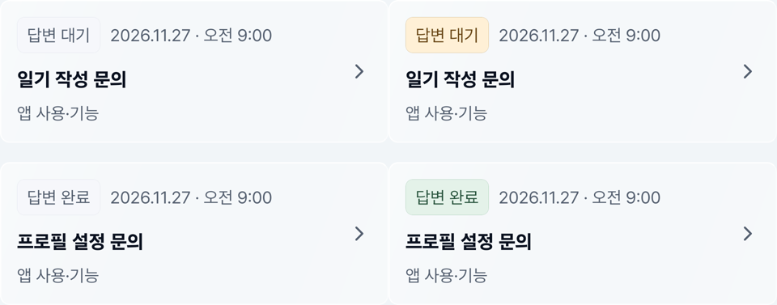

# 누리앱 일반 후보 검증과 남은 작업

2026-11-27 KST. 대상은 S25 Edge의 일반 앱 `com.nuri.app` 내부 Debug 후보다. 제품 설치, 개발 수락, 운영 기능 공개, 스토어 출시는 각각 따로 판정한다.

## 일반 후보와 실측

| 항목 | 이전 | 이번 결과 및 범위 |
| --- | --- | --- |
| 최초 빌드 | 일반 기준 `d5affdd` | `9a03bf04869c7ec91288b5e590c28df844b402c5`. 공식 주소 복사 모듈·의존성·검사만 변경. 빌드 직전 25.052 GiB. 내장 Debug, Metro 없이 실행. |
| 보존 설치 | 기존 로그인 일반 앱 | 같은 서명으로 업데이트. 설치 APK 해시 대조, UID 10402·최초 설치 시각·선택 프로필 불변. 기존 초안별 본문·모든 설정값까지 검증한 것은 아니다. |
| 이메일 복사 | 코어 Clipboard 경고 | 메뉴 재진입 포함 각 2회 복사, 두 방문에서 성공 안내. 기기에서 빈 로컬 입력란에 실제 붙여넣은 결과 공식 주소 18자 일치. 제출·발송 없음. |
| 노란 경고 | 기존 커뮤니티 탭 터치 영역과 겹침 | 전용 모듈로 교체. 복사 전후·탭 이동·재실행 후 UI와 앱 PID의 RN 로그에서 대상 경고 미관측. 배너 은폐·필터 추가 없음. |
| 하단 탭 | 기존 경고 해제 후에만 진입 확인 | 타임라인·커뮤니티·편지함·홈 순차 터치와 재선택. 타임라인 월 격자·커뮤니티 목록·로그인 홈 확인, 편지함 탭 선택 확인. 전체메뉴 열기·닫기와 시스템 Back 확인. |
| 홈 최초 진입 | 전체기록 부근에서 시작한다는 PO 제보 | 기존 앱과 1차 후보에서 상단·중간·하단 → 앱 종료 → 런처 콜드 스타트. 새 PID, 초기·안정 후 같은 프로필 위치. 첫 후보의 이름 위치 [477,1631][602,1736]px. 백그라운드와 메뉴 복귀에서는 내려간 화면에 히어로가 다시 나타나지 않음. 픽셀 단위 스크롤 복원 측정은 아님. |

홈은 초기 route와 로그인 홈 스크롤을 분리해 확인했다. 선택 펫별 스크롤 캐시는 프로세스 메모리이며 데이터 영속 복원이 아니다. 콜드 스타트 오류의 원인은 **미확정**. 이미지 지연·특정 진입 이벤트까지 성공한 것으로 보지 않으며 focus마다 초기화하거나 히어로를 변경하지 않았다. 재현 시 실행 방식, 직전 위치, PID 변경 여부, 첫 레이아웃과 이미지 도착 순서를 같은 실행에서 기록한다.

최종 후보에서도 전체요약 버튼으로 실제 기록 갤러리에 진입했다. Android Back·백그라운드 복귀·메뉴 닫기 직후 버튼 경계는 모두 직전과 같은 [90,2006][525,2079]px였다. 같은 위치에서 프로세스를 종료하고 런처로 다시 열었을 때에는 상단 히어로로 돌아왔다. 이 시험에서는 개별 개인 기록 상세나 초안을 열지 않았다.

## 배지 변경

2차 소스 `dcdff872490d6b65cee5d9b375a27acec8bd4aa5`는 문의 응답 상태의 색과 회귀 검사만 변경했다. 25.084 GiB에서 별도 native build. `InquiryStatus`의 실제 사용처인 내역 및 대화에서 같은 색 토큰을 사용한다. 크기·레이블·서버 상태·읽음·알림은 변경하지 않았다.

| 테마 | 답변 대기: 배경 / 글자 / 테두리 | 답변 완료: 배경 / 글자 / 테두리 |
| --- | --- | --- |
| 밝음 | #FFF0D6 / #684514 / #DDC9A4 (7.63:1) | #E4F2E9 / #28543D / #B9D6C4 (7.49:1) |
| 어두움 | #493A27 / #FFE3AE / #756248 (8.79:1) | #283E34 / #C6EDD5 / #4B6758 (9.01:1) |

기존에는 일반 표면색 또는 미읽음 강조색이 중심이라 두 상태를 색으로 구별하기 어려웠다. 낮은 채도의 앰버와 세이지를 상태 문구와 함께 사용한다. 불투명 배경으로 계절별 유리 패널 색에 따라 글자 대비가 달라지지 않는다. ‘새 답변’, ‘추가 정보 대기’, ‘종료’는 종전대로다. Pinterest 공개 자료 검색에서 직접 확인할 수 있는 시안을 얻지 못해 특정 핀을 근거로 인용하지 않았다.

**S25 직접 확인:** 2차 후보도 같은 앱에 데이터 보존 설치했다. 실기기 기본 시험 구성 360dp·1.0배에서 두 카드의 전후 경계가 픽셀 단위로 같았다. 320dp·2.0배, 384dp·1.0배, 412dp·1.0배에서 두 상태의 문구를 동시에 확인했고 카드끼리 겹치지 않았다. 320dp에서는 날짜가 배지 아래로 내려가고 상태 문구는 한 줄이었다. 360dp에서는 두 상세를 각각 열어 상태를 대조한 뒤 시스템 Back으로 내역에 복귀했다. 360dp 캡처에서 지정한 밝은 테마 배경과 글자색 네 가지를 실제 픽셀로 확인했다. 어두운 색은 컴포넌트 검사이며 네 계절별 실기기 캡처를 수락한 것은 아니다.

비교에는 USB로만 연결한 임시 localhost와 합성 문의 2건을 사용했다. 앱의 내역·상세 컴포넌트는 설치된 일반 APK 그대로다. 이 결과는 인증·운영 API·읽음 계약 시험이 아니다. 임시 연결을 제거하고 기기 표시 설정을 원래대로 돌렸다.

**D 내부 동결: 수락.** 첫 후보와 최종 후보 모두 주소를 기기에서 붙여넣어 대조했고 대상 경고와 탭 차단이 재발하지 않았다. 최종 후보에서는 편지함 전용 화면 문구·월별 타임라인 격자·커뮤니티 목록·홈·전체메뉴와 두 닫기 경로까지 확인했다. 11/26 일반 앱 영향 확인 및 기존 D 792칸은 변경되지 않은 영역에서만 재사용한다. 이번 실측을 D 칸 추가, E 출시 수락 또는 C0 동결로 합산하지 않는다.

최종 후보 소스로 홈 캐시·펫 전환·프로필 사진 등 4개 Jest 스위트 62건과 스크롤·일정 내비게이션·탭 툴바 등 4개 스위트 33건이 통과했다. 자동검사가 외부 인증이나 운영 알림의 원본 증거를 대신하지 않는다.

## 후보 식별 및 검사

| 후보 | APK SHA-256 | 내장 JS SHA-256 | 동일 커밋 CI |
| --- | --- | --- | --- |
| 최초 | `e523edda0386d2f111f7f33812619057365b44b0f8924d80c75acc8ee3375f18` | `c53a5a1a544a4a9962005c68432c4c1e0cd4b1074f869fab3949f7bb4255b37f` | [클립보드 CI](https://github.com/jaejun0617/nuri-app/actions/runs/45923491797) 성공 |
| 배지 | `82db45b5a386579cde8718a7ae562951eebeb98ceccaf2c66618dfde366b4584` | `b954d00794b96e9c32c6b590e44288012eebdde6d9d234974ba5a7b03e5018ce` | [배지 CI](https://github.com/jaejun0617/nuri-app/actions/runs/45924719117) 성공 |

타입·표적 ESLint·관련 Jest·제품 소스 가드와 Android Debug 빌드를 구분했다. 배지 표적 Jest는 2개 스위트 23개. 비공개 영수증은 `~/.codex/n15-local/general-1127-hS7jmKlF`와 `general-badge-1127-pZIa9gvd`. APK·개인 화면·인증 자료는 Git에 포함하지 않는다.

## 지금 어디까지 왔나

| 작업 | 현재 수락 | 남은 조건 |
| --- | --- | --- |
| D 반응형 개발 | **792/792 (100%)**. 직접 760, 재사용 32. 신규 칸 없음 | GPS G11 8칸은 Walk GPS Phase 6 이관. 튜토리얼 176칸은 역사 분모에서 제외한 것이지 PASS가 아니다. |
| 내부 QA | U3 OS 알림 13/13, U5 기록 4/4 기존 동결 유지 | 다른 단위나 전체 C0로 확대하지 않는다. |
| 통합 검증 | **4/7 (57.1%)**. B1·B2·U3·U5 | U1 Google 별도 동의·재인증과 연결 실패의 동일 사용자 복귀, U2 적격 자연 수신 공지·정책 원본, NAV-01 외부 실패·취소 복귀와 과거 종료 제보 조건. 기존 정상 경로·격리 저장 재시도는 반복하지 않는다. |
| E 공개 전 | **3/4 (75%)**. 공식 창구·운영 권한·단건 복구 | 독립 암호화 매체와 복구키 확보 후 DB+첨부 동시 복원, 파기 A 비노출·대조 B 보존, 실제 메일 사본 정책·출시 직전 비로그인 개인정보 고지. Mac 내부 합성 시험은 물리 백업 증거가 아니다. |
| P0·C0·STORE | P0 장기 안정성·최종 PARTIAL, C0 미동결, **STORE HOLD** | SU-544458 실질 회신 또는 PO 위험 판단, 통합 잔여와 확정 후보 검토 후 별도 Go/No-Go. 월간 요약·함께한 달 전체 범위 보류 유지. 서로 다른 분모를 합산하지 않는다. |

격리에서 PASS한 것은 지정 서버·계정·화면을 시험했다는 뜻이다. QA 전용 로그인과 서버를 일반 앱에 넣지 않는다. 운영 E 연결은 사용자 공지·FAQ·문의 → 계정 경계와 지정 답변 이동 → PO 전용 단건 복구·위임 회수 → 정식 비공개 HTTPS 첨부 순으로 제품·서버·호스팅 선행조건을 구분한다. 이번 설치가 이를 모두 공개한 것은 아니다. 후속 기능 기획은 [정본](../planning/NURI-APP-next-work-plan-2026-11-22.md), 실제 수락 이력은 [통합 원장](../qa/nuri-integrated-closeout-2026-10-25.md)을 따른다.
