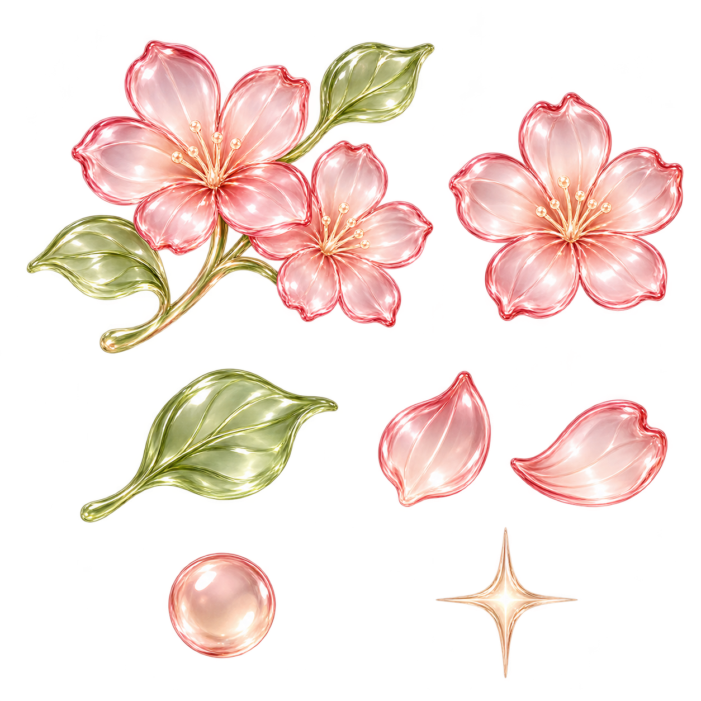
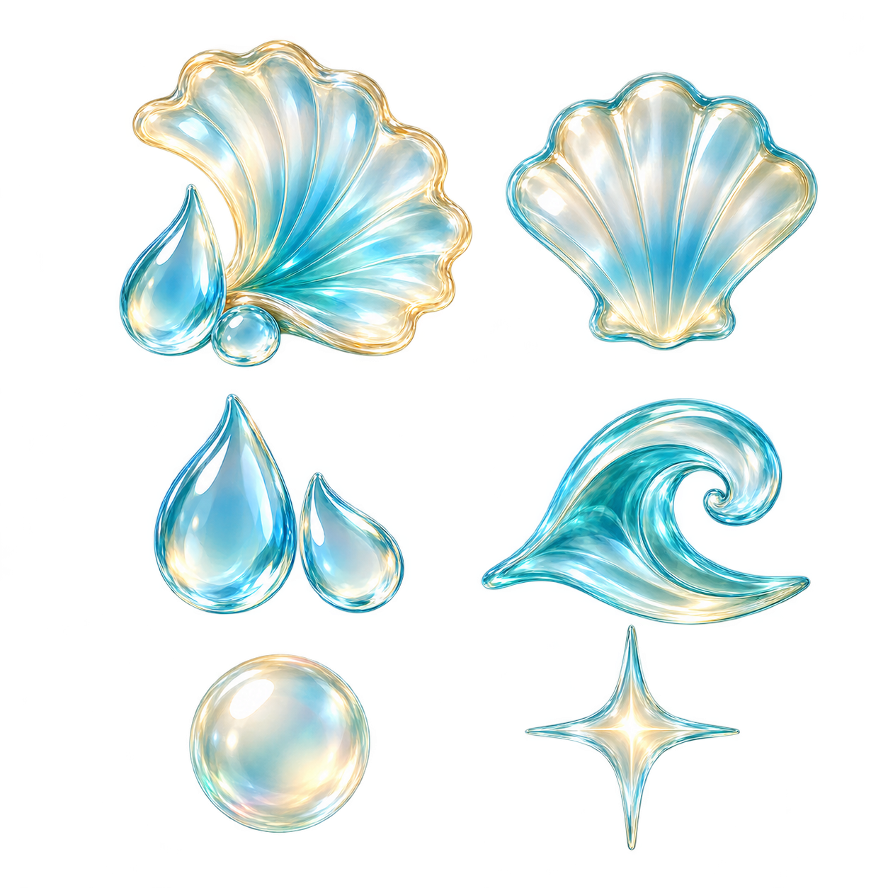
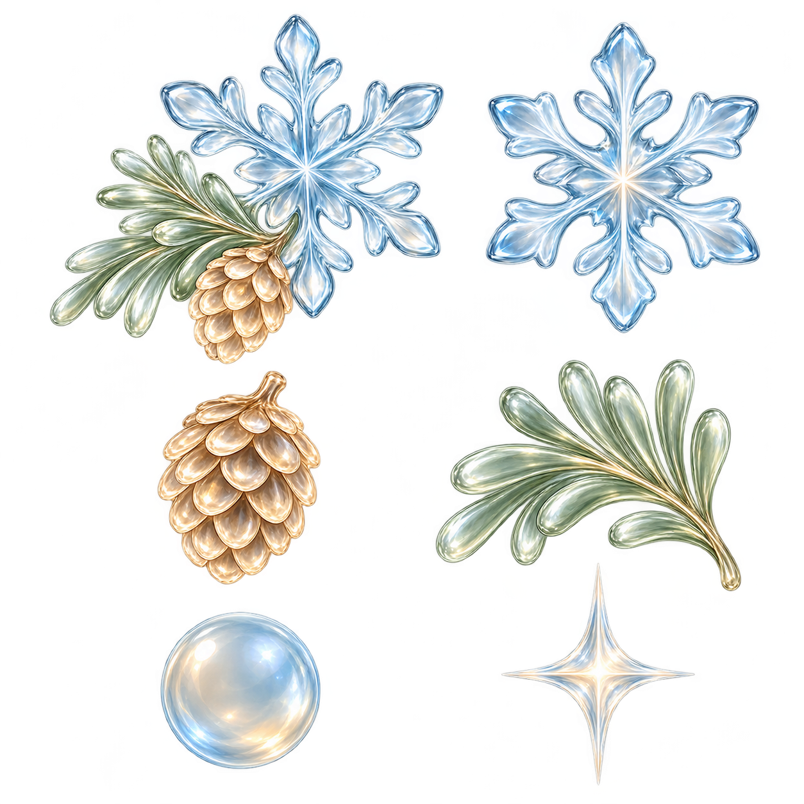

# NURI Spring / Summer / Winter Colored Glass Concepts

2026-10-17. Built-in image_gen. 계절별 세트 원본을 보존하며 후속 PO 승인으로 Home Metro 후보에 연결했다.

## 봄

벚꽃 묶음·벚꽃 한 송이·새잎·꽃잎 두 장·분홍빛 구체·별빛을 분홍/세이지 색유리로 구성했다.

## 여름

조개와 물방울 묶음·조개·물방울 두 개·파도·물빛 구체·별빛을 아쿠아/청록과 옅은 샴페인빛으로 구성했다.

## 겨울

눈꽃/솔잎/솔방울 묶음·눈꽃·솔방울·솔잎·얼음빛 구체·별빛을 옅은 파랑/세이지/샴페인 색유리로 구성했다.

## 범위와 검증

- 각 PNG는 여섯 종류를 비교하는 한 장의 세트 시안이다. 후속 PO 승인으로 exact copy를 runtime atlas로 재사용하며 큰 묶음/단일 소품/구체 영역만 고정 native viewport로 표시한다. 원본 PNG를 자르거나 재가공하지 않았고 세트 전체를 화면에 표시하지 않는다.
- PNG decode·실제 alpha channel·copy/source hash 일치·주요 형상의 canvas 내부 bounds를 확인했다. 원본 그대로 보관하며 작은 화면 적용/실기기 QA 완료를 주장하지 않는다.
- 원본의 일부 가장자리와 봄/겨울 모서리에 alpha1 픽셀이 있다. 배경 그림이 아니라 매우 낮은 alpha 잔여이며 임의 제거하지 않았다. 완전 alpha0 모서리 검사는 해당 두 이미지에서 미통과다.
- [manifest.json](manifest.json)에 전체 제작 프롬프트·실제 크기/해시/투명도·생성 원본 경로를 보존했다. 가을 소품을 재질 참조로만 사용했다.
- 가을의 직접 Image·배치와 기존 Home UI/글씨/CTA/52dp 간격은 유지한다. 봄은 벚꽃 묶음/한 송이, 여름은 조개 묶음/조개, 겨울은 눈꽃/솔잎/솔방울 묶음과 단일 눈꽃이다. 아래는 승인된 공통 별빛57개와 계절 구체5개이며 중간 행의 추가 소품은 아래 카드에 넣지 않는다.
- [runtime source manifest](../../../src/assets/seasonal/home/home-colored-glass-seasons-v1.source.json)가 source hash·표시 영역/크기·구성 소유 파일을 기록한다. 관련15 suites/381 tests·타입·대상 lint0/0·Metro bundle200 PASS이며 native 실기기 시각/성능 완료를 주장하지 않는다.
- 원본 dirty181·기존 다른 디자인·성능/Walk/native/서버를 보존하고 Build/install/commit/push0·STORE HOLD다. 다음은 PO의4계절 Metro 검토이며 다음 작업을 자동 시작하지 않는다.
